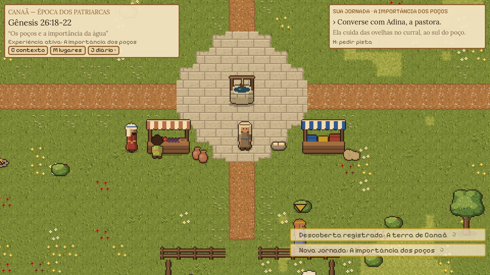

# Caminhos da Promessa

RPG de exploração em pixel art 2D (Godot 4) que leva o jogador aos cenários da
Bíblia. Versão atual: **v0.5.0**, um protótipo jogável com três regiões (Aldeia em Canaã,
Caminho das Caravanas e Pastos de Dotã), cinco missões (Gênesis 26 e 37), diário, bolsa,
Mapa das Escrituras e efeitos sonoros provisórios. Estado detalhado em
[docs/ai-wiki/CURRENT_STATE.md](docs/ai-wiki/CURRENT_STATE.md).



## Como jogar

1. Abra o executável do Godot 4.7: `tools/godot/Godot_v4.7.2-stable_win64.exe`.
   Se a pasta não existir, baixe o **Godot 4.7.2 (Standard, Windows 64-bit)** em
   [godotengine.org](https://godotengine.org/download) e extraia em `tools/godot/`.
   A build do exe exige templates exatamente desta versão.
2. Importe/abra a pasta do projeto e pressione **F5**. Pelo terminal:
   `.\tools\godot\Godot_v4.7.2-stable_win64.exe --path .`

| Ação | Tecla |
|---|---|
| Andar | WASD ou setas |
| Correr | Shift |
| Interagir / avançar diálogo | E ou Espaço |
| Pedir pista do objetivo | H |
| Diário (jornada, Escrituras, personagens, lugares, linha do tempo, descobertas) | J |
| Bolsa | I |
| Mapa das Escrituras (experiências por época e atlas de lugares) | M |
| Contexto bíblico | C |
| Recolher painel de contexto / trocar aba do diário | Tab |
| Pular cena / pausar / salvar / volumes | Esc |
| Painel de debug (só rodando pelo editor) | F3 |

Missões: **A importância dos poços** (Gênesis 26:18-22), **O caminho para Dotã** (Gênesis 37:12-17) e três
secundárias na estrada e em Dotã. Detalhes e roteiro de teste em [docs/quests.md](docs/quests.md).

## Estrutura

```
assets/      arte (provisória, gerada), sons (procedurais), fontes, paletas, shaders, tema
addons/      editor de missões (plugin do Godot; fora da build)
data/        personagens, regiões, diálogos, missões, itens, colecionáveis, áudio e catálogo bíblico (JSON)
scenes/      core (jogo), player, npcs, environments, maps, ui
scripts/     core, player, npc, interaction, dialogue, items, save, world, ui, bible, quests, build
tests/       testes automatizados
tools/       geradores de arte, mundo e sons, capturas, validador, fábrica de missões, build
production/  fábrica de missões: catálogo de episódios, pacotes, relatórios
docs/        art bible, game design, arquitetura, áudio, catálogo bíblico, roadmap, histórico
docs/ai-wiki/ memória do projeto para agentes de IA (ver AGENTS.md)
.cursor/     subagentes e regras do Cursor (ver docs/ai-wiki/AI_AGENTS.md)
```

## Ferramentas

```powershell
.\tools\build_all.ps1              # regenera arte e mundo, roda os testes
.\tools\build_all.ps1 -PropsOnly   # não sobrescreve o mapa da aldeia
.\tools\build_all.ps1 -Screenshots # também atualiza docs/images (precisa de GPU)
.\criar_exe_atualizado.bat         # gera/atualiza CaminhosDaPromessa.exe na raiz (dois cliques)
```

Detalhes do executável Windows: [docs/build_windows.md](docs/build_windows.md).

## Documentação

- **Agentes de IA e continuidade:** comece por [AGENTS.md](AGENTS.md) e pela [AI Wiki](docs/ai-wiki/README.md)
  (estado atual, passagem de bastão, regras bíblicas e de desenvolvimento, decisões).
- [Art Bible](docs/art_bible.md)
- [Game Design](docs/game_design.md)
- [Arquitetura](docs/architecture.md)
- [Catálogo Bíblico](docs/bible_catalog.md)
- [Missões, contexto histórico e aprendizado](docs/quests.md)
- [Efeitos sonoros](docs/audio.md)
- [Fábrica de missões](docs/mission_factory.md)
- [Roadmap](docs/roadmap.md)
- [Histórico de implementação](docs/implementation_log.md)

## Licenças

- Código, arte provisória e efeitos sonoros procedurais: criados para este projeto (sem licença de distribuição definida ainda).
- Fonte Pixelify Sans: SIL Open Font License 1.1 (`assets/fonts/OFL.txt`).
- Fonte Lora: SIL Open Font License 1.1 (`assets/fonts/OFL-Lora.txt`).
- Texto bíblico: Bíblia Portuguesa Mundial (domínio público), eBible.org — ver `docs/bible_catalog.md`.
- Godot Engine: licença MIT.
