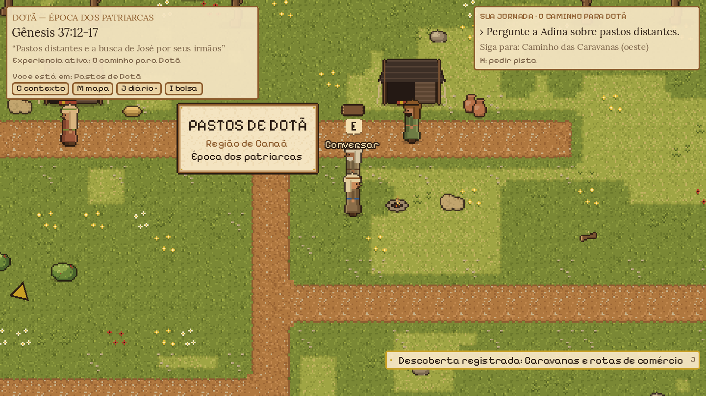
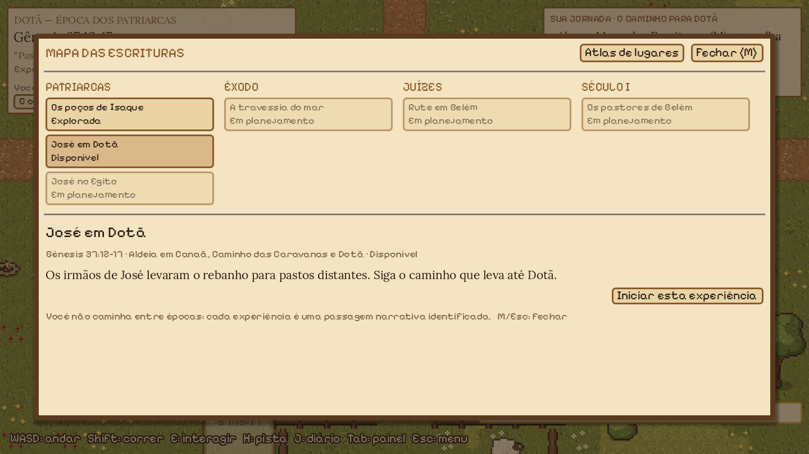
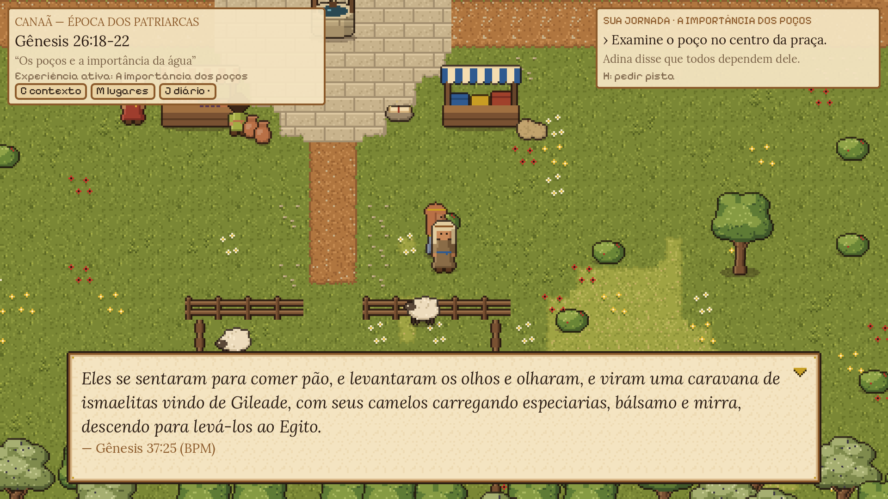
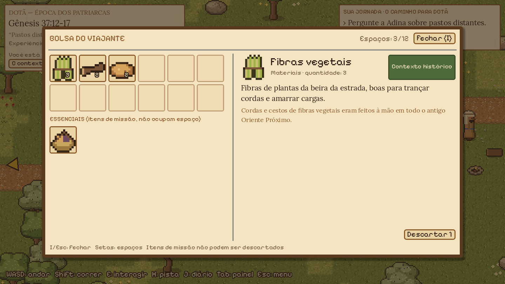

# Caminhos da Promessa

RPG 2D em pixel art (vista 3/4) para **conhecer e contextualizar a Bíblia**. Você é um viajante
fictício que caminha pelos cenários dos relatos bíblicos, conversa com moradores, explora, ajuda e
aprende, **sem alterar o que a Bíblia narra**. Feito com Godot 4.7 e GDScript, em português do Brasil.

[](https://github.com/maicontalgatti/Caminhos-da-Promessa/actions/workflows/tests.yml)


| | |
|---|---|
|  |  |
|  |  |

*Capturas reais do jogo (v0.4–v0.5). Arte e sons ainda são provisórios.*

## Estado do desenvolvimento
**v0.5.0, protótipo jogável.** Prontos e cobertos por testes automatizados:
- três regiões (Aldeia em Canaã, Caminho das Caravanas, Pastos de Dotã) e cinco missões ligadas a
  Gênesis 26 e 37;
- diálogos com escolhas e consequências, diário com seis abas, descobertas, bolsa, colecionáveis;
- Mapa das Escrituras, save com migração, efeitos sonoros procedurais;
- exe único para Windows com autoteste.

O conteúdo bíblico e histórico **ainda não passou por revisão humana**: está marcado como pendente
dentro do jogo. Estado detalhado: [docs/ai-wiki/CURRENT_STATE.md](docs/ai-wiki/CURRENT_STATE.md).
Planos: [docs/roadmap.md](docs/roadmap.md).

## Como executar localmente
Requisitos: Windows 10/11 (o jogo e as ferramentas foram feitos nele; Linux roda os testes na CI) e o
**Godot 4.7.2 Standard** (64 bits).

1. Clone o repositório:
   ```powershell
   git clone https://github.com/maicontalgatti/Caminhos-da-Promessa.git
   cd Caminhos-da-Promessa
   ```
2. Baixe o Godot 4.7.2 em [godotengine.org](https://godotengine.org/download/archive/4.7.2-stable/) e extraia
   em `tools/godot/` (pasta fora do Git). Os comandos abaixo esperam
   `tools/godot/Godot_v4.7.2-stable_win64.exe` e `..._win64_console.exe`.
3. Importe o projeto (duas vezes na primeira vez: a primeira mostra avisos de fontes que somem na segunda):
   ```powershell
   $g = ".\tools\godot\Godot_v4.7.2-stable_win64_console.exe"
   & $g --headless --path . --import
   & $g --headless --path . --import
   ```
4. Jogue: `.\tools\godot\Godot_v4.7.2-stable_win64.exe --path .` (ou abra no editor e pressione **F5**).
5. Rode os testes: `& $g --headless --path . res://tests/test_runner.tscn` (deve terminar em "0 falharam").

Para gerar o executável: `.\criar_exe_atualizado.bat` (exige os templates de exportação 4.7.2; ver
[docs/build_windows.md](docs/build_windows.md)).

### Controles
| Ação | Tecla |
|---|---|
| Andar / correr | WASD ou setas / Shift |
| Interagir, avançar diálogo | E ou Espaço |
| Pista do objetivo | H |
| Diário / Bolsa / Mapa das Escrituras / Contexto bíblico | J / I / M / C |
| Recolher painel, trocar aba | Tab |
| Pausar, salvar, volumes | Esc |

## Desenvolva este jogo com sua própria IA
O projeto foi organizado para que **qualquer agente de IA** (Cursor, Claude Code, Codex, Copilot, Gemini,
Windsurf, Aider ou outro) consiga entender o estado atual e continuar o trabalho sem conhecer conversas
anteriores. A memória do projeto fica na [AI Wiki](docs/ai-wiki/README.md), e o ponto de entrada para
agentes é o [AGENTS.md](AGENTS.md).

Clone o repositório, abra a pasta na sua ferramenta e use o prompt de [START_WITH_AI.md](START_WITH_AI.md).
Versão curta, para copiar:

```text
Você vai colaborar no jogo "Caminhos da Promessa". Leia START_WITH_AI.md e siga as instruções:
leia AGENTS.md, a AI Wiki (docs/ai-wiki/README.md, CURRENT_STATE.md, HANDOFF.md), confira o estado
do Git, rode só verificações seguras e me apresente um resumo com sugestões de tarefas.
Não altere nada até eu escolher o que desenvolver.
```

O agente não substitui a revisão de pessoas: conteúdo bíblico produzido por IA é sempre marcado como
pendente até uma revisão humana independente.

## Como contribuir
Contribuições são bem-vindas: correções, testes, ferramentas, arte, sons, missões bíblicas e revisão de
conteúdo. Leia [CONTRIBUTING.md](CONTRIBUTING.md) antes. O fluxo é: fork ou branch → desenvolvimento →
testes → documentação → pull request → revisão → merge. Ninguém altera a `main` sem revisão.

- Bugs e ideias: [issues](https://github.com/maicontalgatti/Caminhos-da-Promessa/issues/new/choose).
- Correções de conteúdo bíblico: modelo "Correção bíblica" nas issues.
- Vulnerabilidades: siga o [SECURITY.md](SECURITY.md) (não abra issue pública).
- Convivência: [CODE_OF_CONDUCT.md](CODE_OF_CONDUCT.md).

## Conteúdo bíblico
- O jogo apresenta os relatos sem alterá-los. O viajante, os moradores fictícios e as tarefas que eles
  pedem são **ficção identificada**; fatos do texto, contexto histórico e interpretações aparecem
  separados.
- Regras completas: [docs/ai-wiki/BIBLICAL_RULES.md](docs/ai-wiki/BIBLICAL_RULES.md).
- Texto bíblico: **Bíblia Portuguesa Mundial** (domínio público, [eBible.org](https://ebible.org/)), uma
  tradução ainda em rascunho. Traduções modernas protegidas (NVI, ARA etc.) não são usadas.

## Estrutura
```
assets/      arte (gerada por código), sons (procedurais), fontes, paletas, shaders
addons/      editor de missões (plugin do Godot)
data/        personagens, regiões, diálogos, missões, itens, áudio e catálogo bíblico (JSON)
scenes/      cenas do jogo        scripts/   código GDScript
tests/       testes automatizados tools/     geradores, validador, fábrica de missões, build
production/  fábrica de missões   docs/      design, arquitetura, áudio, AI Wiki, licenças
.cursor/     subagentes e regras para quem usa o Cursor
```

Documentação: [arquitetura](docs/architecture.md) · [game design](docs/game_design.md) ·
[art bible](docs/art_bible.md) · [missões](docs/quests.md) · [catálogo bíblico](docs/bible_catalog.md) ·
[áudio](docs/audio.md) · [fábrica de missões](docs/mission_factory.md) ·
[histórico](docs/implementation_log.md) · [mudanças](CHANGELOG.md).

## Licenças
- **Código:** [MIT](LICENSE).
- **Arte, sons e textos próprios do projeto:** [CC BY 4.0](LICENSE-ASSETS.md).
- **Material de terceiros** mantém a licença original: fontes Pixelify Sans e Lora (SIL Open Font License
  1.1, `assets/fonts/OFL*.txt`); texto da Bíblia Portuguesa Mundial (domínio público, eBible.org).
- O Godot Engine (MIT) não faz parte do repositório.

Inventário completo de origem e licença: [docs/legal/ASSET_LICENSES.md](docs/legal/ASSET_LICENSES.md).
