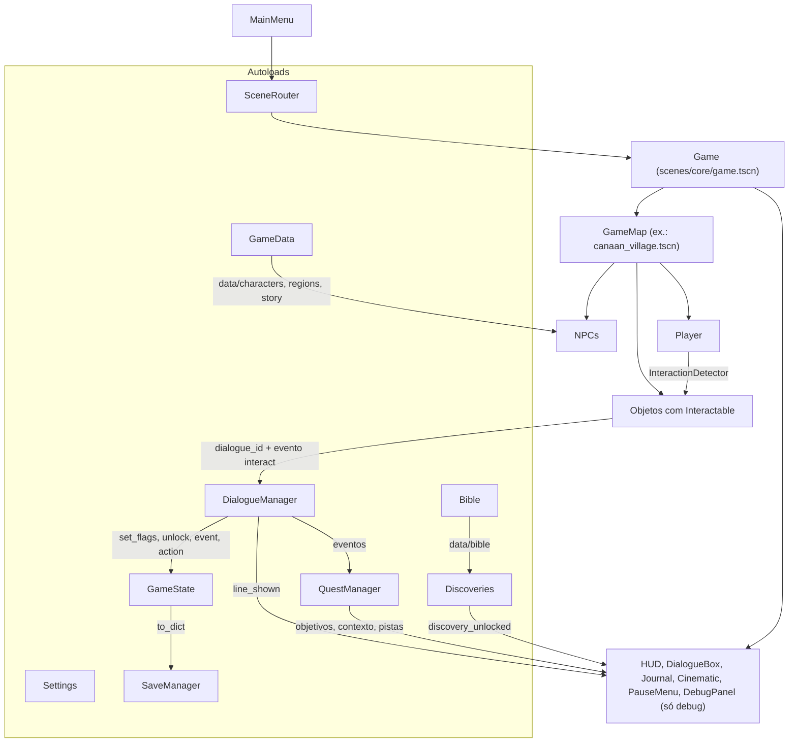

# Arquitetura — Caminhos da Promessa

Godot 4.7 · GDScript · renderizador Compatibility (OpenGL 3.3 / WebGL 2).

## Visão geral



## Autoloads (ordem de carga)

| Nome | Arquivo | Responsabilidade |
|---|---|---|
| `Settings` | `scripts/core/settings.gd` | Tela cheia, volume, frequência dos avisos educativos e painel recolhido, em `user://settings.cfg` |
| `GameData` | `scripts/core/game_data.gd` | Personagens, regiões e prólogos de `data/`; retratos |
| `Bible` | `scripts/bible/bible.gd` | Catálogo bíblico (`BibleCatalog`): livros, contagem de versículos, histórias, descobertas, cronologia, lugares, pessoas, apresentações |
| `SaveManager` | `scripts/save/save_manager.gd` | JSON versionado (v2), `.tmp` + `.bak`, validação e migração. Não conhece o GameState |
| `GameState` | `scripts/core/game_state.gd` | Mapa, posição, flags, missões, descobertas, histórico, tempo; bloqueio de UI (`block_ui`) |
| `DialogueManager` | `scripts/dialogue/dialogue_manager.gd` | Fluxo de diálogos (nós, escolhas, condições, flags, descobertas, eventos, ações) |
| `QuestManager` | `scripts/quests/quest_manager.gd` | Missões por eventos, pistas, contexto ativo; controle usado pelo debug |
| `Discoveries` | `scripts/bible/discoveries.gd` | Registro de descobertas e do que o jogador já conhece (pessoas, lugares, referências) |
| `SceneRouter` | `scripts/core/scene_router.gd` | Troca de cena com fade; autoteste do .exe |

Missões, descobertas, diário, cronologia e ferramentas: ver [quests.md](quests.md).

## Componentes reutilizáveis

- **`Interactable`** (`Area2D`, camada 4): único componente de interação. Propriedades `kind` (TALK, EXAMINE, READ, COLLECT, OPEN, DOOR), `dialogue_id`, `prompt_text`, `prompt_offset`, `set_flag_on_interact`; sinal `interacted(interactor)`. Comportamentos específicos escutam o sinal em vez de duplicar código.
- **`InteractionDetector`** (no jogador): escolhe o alvo mais próximo, com bônus para o que está à frente.
- **`CharacterSprite`** (`Sprite2D`): anima qualquer folha no padrão do art bible (4 ou 2 direções).
- **`NPC`**: configurado por `character_id` → `data/characters/*.json` (sprite, comportamento, diálogo).
- **`GameMap`**: base de mapas (spawn/posição salva, limites de câmera, região).

## Camadas de física

| Camada | Uso |
|---|---|
| 1 `world` | objetos de cenário, limites do mapa |
| 2 `player` | jogador |
| 3 `npc` | NPCs e animais |
| 4 `interactable` | áreas de interação |

## Cena de mapa

```
CanaanVillage (GameMap)
├─ Ground / DryGrass / Plaza / Paths / Decor   (TileMapLayer, z -12..-8)
├─ World (Node2D, y_sort_enabled)
│   ├─ PlayerSpawn (Marker2D)
│   ├─ Player
│   ├─ objetos (scenes/environments/*.tscn)
│   └─ NPCs (scenes/npcs/npc.tscn + character_id)
├─ Bounds (StaticBody2D)
└─ DaylightTint (CanvasModulate)
```

## Formatos de dados

### Diálogo (`data/dialogues/*.json`, chave `dialogues`)

```json
{
  "id": "adina_talk",
  "start": "greet",
  "start_if": [{"flag": "met_adina", "node": "again"}],
  "nodes": {
    "greet": {"speaker": "adina", "text": "...", "next": "ask", "set_flags": ["met_adina"]},
    "ask": {"speaker": "adina", "text": "...", "choices": [
      {"text": "...", "next": "flock", "flag": "opcional", "not_flag": "opcional"}
    ]}
  }
}
```
`speaker`: id de personagem, `narrator` (sem nome) ou `player`. `next: "end"` encerra.
Validação automática: nó inicial, `next` e escolhas apontando para nós existentes.

### Personagem (`data/characters/*.json`, chave `characters`)

`id`, `display_name`, `role`, `kind` (`person`/`animal`), `classification`,
`description`, `dialogue_id`, `prompt` (opcional), `sprite {sheet, hframes, vframes, directions, portrait}`,
`behavior {type: idle|wander, speed, wander_radius, facing_x, facing_y}`.

### Região (`data/regions/*.json`, chave `regions`)

`id`, `display_name`, `subtitle`, `biome`, `map_scene`, `classification`, `notes`, `related_stories`,
`context {place_id, era_id, references[], theme, discoveries_on_enter[]}` (painel de contexto e descobertas ao entrar; v0.2).

### Catálogo bíblico

Ver `docs/bible_catalog.md` e `scripts/bible/bible_catalog.gd`.

### Save (`user://savegame.json`)

```json
{"version": 2, "saved_at": "...", "game": {
  "current_map": "res://scenes/maps/canaan_village.tscn",
  "player_position": {"x": 480, "y": 388},
  "player_facing": {"x": 0, "y": 1},
  "flags": {"met_adina": true, "prologue_seen": true, "ev:custom:wells_adina_water": true},
  "quests": {"canaan_wells": {"status": "active", "objective": 1, "hints": {"meet_adina": 2},
             "started": 12.0, "completed": 0.0, "objective_started": 80.5}},
  "discoveries": {"shepherding_water": 80.5},
  "log": [{"kind": "discovery", "id": "shepherding_water", "t": 80.5}],
  "play_time": 123.4}}
```
- Gravação atômica (`.tmp` → renomeia) com cópia `.bak` do save anterior.
- Leitura: JSON inválido, versão futura ou campos inválidos → tenta `.bak` → mensagem amigável. Missões com status desconhecido e descobertas malformadas são descartadas.
- `SaveManager.migrate()` é o ponto único para converter versões antigas. v1 → v2: o prólogo é dado como visto e a missão-piloto começa ao carregar.
- Fechar a janela durante o jogo salva automaticamente.

## Pipeline de conteúdo

```
tools/art_gen/generate_art.gd   → PNGs provisórios + paletas
godot --import
tools/art_gen/build_world.gd    → theme.tres, tileset, scenes/environments/*, canaan_village.tscn
tests/test_runner.tscn          → 208 verificações automáticas
tests/flow_smoke.gd             → fluxo real pelos menus (17)
tools/validate_content.gd       → erros de dados + situação de revisão
tools/screenshot/capture.tscn   → capturas em docs/images (requer GPU)
```
Tudo de uma vez: `.\tools\build_all.ps1 [-Screenshots]`.

**Atenção:** `build_world.gd` regenera `canaan_village.tscn`. Quando o mapa
passar a ser editado à mão no editor, rode com `-PropsOnly` para não sobrescrevê-lo.

## Adicionando conteúdo

- **Novo morador**: entrada em `data/characters/*.json` + diálogo em `data/dialogues/*.json` + instância de `npc.tscn` no mapa com `character_id`.
- **Novo objeto interativo**: entrada em `PROPS` (build_world) ou cena com um nó `Interactable` e `dialogue_id`.
- **Novo mapa**: cena com raiz `GameMap`, `World` com `y_sort_enabled`, `PlayerSpawn` e `Player`; região em `data/regions`.
- **Nova história bíblica**: entrada em `data/bible/stories/*.json` (validada pelos testes). Toda referência nova exige o capítulo em `data/bible/verse_counts.json`.
- **Nova missão**: `data/quests/<região>/*.json` ou pelo editor de missões (aba Missões). Ver [quests.md](quests.md).
- **Nova descoberta / lugar / pessoa / época**: `data/bible/discoveries.json`, `places.json`, `people.json`, `chronology.json`, sempre com `verification.status` = `pending_review` até revisão humana.

## Exportação

Preset `Windows Desktop` em `export_presets.cfg`, com o PCK embutido no .exe.
Arquivos `.json` não são recursos importados; por isso o preset inclui o filtro
`data/*.json` em “Filters to export non-resource files”. Esse filtro também
pega as subpastas, o que foi verificado pelo autoteste do executável.
Para gerar o executável, ver [build_windows.md](build_windows.md).
