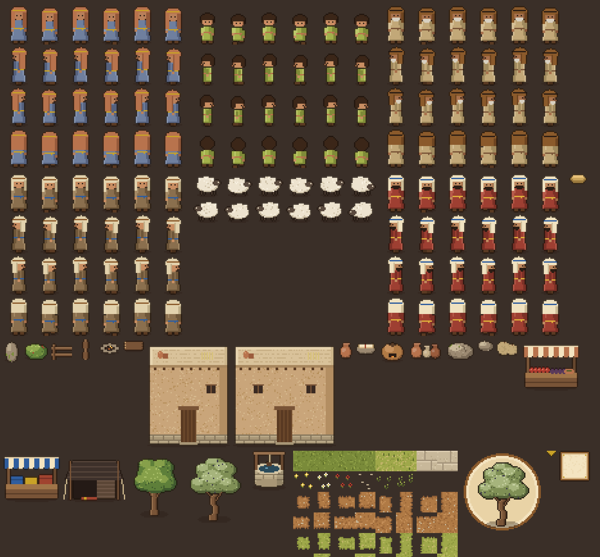
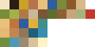

# Art Bible — Caminhos da Promessa

Versão 0.1 (protótipo). Referência obrigatória para toda arte do jogo.
Fonte única das cores em código: `tools/art_gen/art_spec.gd`.

## 1. Identidade visual

Pixel art 2D estilizada, acolhedora e reverente. Referências de *experiência*
(não de cópia): a perspectiva e a organização de Stardew Valley, a atmosfera e a
profundidade de Don't Starve. O jogo tem identidade própria: terras do antigo
Oriente Próximo, materiais naturais (barro, pedra, lã, madeira, linho) e luz quente.

Sensações-alvo: aconchego, descoberta, vida cotidiana, mistério em ruínas e
reverência nos acontecimentos espirituais. Nem infantil demais, nem sombrio.

## 2. Perspectiva e câmera

- Top-down 3/4: vemos o topo e a fachada sul de construções e objetos.
- Movimento livre em 8 direções; sprites com 4 direções visuais.
- Câmera acima do jogador, com suavização (`position_smoothing_speed = 7`) e limitada às bordas do mapa.
- Profundidade por ordenação Y: a origem (“pés”) de cada objeto define quem fica na frente.
- Proibido: visão lateral de plataforma e isometria rígida.

## 3. Especificações técnicas

| Item | Valor |
|---|---|
| Resolução interna | 480 × 270 (16:9) |
| Janela padrão | 1440 × 810 (escala 3×) |
| Stretch | `canvas_items` + escala inteira |
| Filtro | nearest (sem suavização) |
| Tile | 16 × 16 px |
| Personagem adulto | 24 × 32 px (criança: mesmo quadro, corpo menor) |
| Origem | centro inferior, nos pés (pixel y = altura − 1) |
| Animais pequenos | 24 × 20 px |

Decisão: `canvas_items` em vez de `viewport` para que textos fiquem nítidos em
qualquer escala, mantendo a arte com escala inteira e filtro nearest.

## 4. Paletas

Regras gerais: nada de preto puro (contornos em `#2B1D14` misturado à cor do
vizinho), sombras puxadas para marrom/roxo, luzes para amarelo; luz vindo do
alto à esquerda. Arquivos `.gpl` (GIMP/Aseprite) em `assets/palettes/`.

| Região | Cores principais |
|---|---|
| Identidade | Pergaminho `#F4E4C1`, Tinta `#2B1D14`, Dourado `#C9A227`, Terracota `#B8734D`, Areia `#E8C27A`, Azul `#2F5D9E`, Oliva `#7A8B3A` |
| Canaã | Oliva `#7A8B3A`, Verde seco `#A3B14B`, Terra `#B07A45`, Pedra `#C8B89A`, Madeira `#795437` |
| Egito | Areia `#E8C27A`, Arenito `#C2733F`, Azul egípcio `#2F5D9E`, Ouro `#E0B03A`, Nilo `#3F8F8A` |
| Deserto / Êxodo | Areia `#E6B876`, Sombra de duna `#BF8754`, Rocha `#92765C`, Mar `#1F5F7A`, Água iluminada `#3A8FB0` |
| Galileia / Jordão | Verde `#6F8F3C`, Rio `#4A9BB5`, Pedra `#9C8A72`, Areia `#D7C29A`, Luz `#FFF3C4` |
| Jerusalém | Definida por época (ver 4.1) |

### 4.1 Jerusalém por época (a definir antes de produzir)

- Monarquia / Primeiro Templo: pedra calcária clara, cedro, bronze.
- Pós-exílio (Esdras/Neemias): muralhas em reconstrução, materiais simples.
- Período herodiano (Evangelhos/Atos): calcário dourado, colunatas, influência greco-romana.
A cidade nunca reutiliza o mesmo tileset entre épocas sem adaptação.

## 5. Padrões de cenário (Canaã)

- Casas de pedra e barro rebocado, **telhado plano** de vigas, galhos e barro (pontas das vigas visíveis), janelas pequenas e altas, porta de madeira com verga. Nada de telhado inclinado europeu.
- Tendas de pelo de cabra escuro com listras, estacas e cordas.
- Poço de pedra com estrutura de madeira; forno de barro (com fumaça).
- Olivais em fileiras, carvalhos/terebintos, arbustos, pedras, anêmonas vermelhas.
- Caminhos de terra, grama seca e praça de pedra com **bordas irregulares (autotile de 16 máscaras)** — nunca bordas quadradas.
- Mercado: bancas com toldo listrado, romãs, figos, azeitonas, tecidos tingidos.

## 6. Iluminação

- Protótipo: tom diurno quente fixo (`CanvasModulate` `#FFF7E8`).
- Planejado: ciclo dia/noite por `CanvasModulate` animado — manhã dourada, meio-dia neutro, tarde laranja, noite azul-violeta; luzes pontuais (fogueiras, lamparinas) com `PointLight2D`.
- Milagres: luz suave branco-dourada `#FFF8E0`, partículas discretas, silêncio do som ambiente, vento e água em movimento. Usar com moderação; nunca efeitos de “magia” genérica.

## 7. Animação

| Sprite | Layout | Velocidade |
|---|---|---|
| Personagem | 6 colunas × 4 linhas (baixo, esquerda, direita, cima); col. 0–3 andar, 4–5 parado | andar 8 fps (escala com a velocidade), parado 1,5 fps |
| Animal | 6 colunas × 2 linhas (direita, esquerda) | idem |
| Vegetação | shader `assets/shaders/sway.gdshader` (balanço da copa, base fixa) | contínuo |
| Fogo, fumaça, brilho | `CPUParticles2D` de 1–2 px | — |

Diagonais usam a linha horizontal (como no Stardew). Esquerda é o espelho da direita.

## 8. Interface

- Materiais: pergaminho, couro, madeira, dourado discreto. Nada futurista.
- Painel 9-patch `assets/ui/panel_parchment.png` (margem 7 px).
- Botões: fundo pergaminho escuro, borda couro; foco/hover com borda dourada.
- Fontes (ADR-018):
  - **Pixelify Sans** (SIL OFL 1.1, `assets/fonts/OFL.txt`) em títulos, botões, etiquetas e dicas de tecla. Tamanhos-base: 9, títulos 11–26, notas 6–7 (unidades da resolução interna).
  - **Lora** (SIL OFL 1.1, `assets/fonts/OFL-Lora.txt`) em textos de leitura: `RichTextLabel` (tema; itálico para citações bíblicas) e `Label` com quebra de linha (`UiStyle.label(..., wrap=true)`), com `line_spacing` 0.
- Seta de objetivo: triângulo dourado `#c9a227` com contorno `#2b1d14` (`ObjectiveGuide`).
- Diálogo: caixa inferior, nome em couro `#8B5A2B`, retrato recortado do sprite, texto letra a letra, seta dourada para continuar, escolhas como botões.
- Indicador de interação: balão “E” sobre o alvo + verbo contextual (“Conversar”, “Examinar”, “Ler diário”).

## 9. Regras de consistência

1. Toda cor nova entra primeiro em `art_spec.gd` e nesta tabela.
2. Contorno colorido em todos os sprites de objetos e personagens; tiles de chão sem contorno.
3. Toda sombra de chão é elipse semitransparente (alpha ~0,32) sob os pés.
4. Escala: a porta de uma casa é mais alta que um adulto (porta 26 px vs. personagem 32 px com cabeça).
5. Proporção de detalhe: objetos pequenos têm poucos pixels de textura; nada de ruído excessivo.
6. Vestuário e arquitetura devem ser plausíveis para a época; dúvidas são registradas em `implementation_log.md`.

## 10. Assets do protótipo

Todos gerados proceduralmente por `tools/art_gen/generate_art.gd` (**provisórios**,
devem ser substituídos por sprites desenhados à mão mantendo dimensões e origem).

| Arquivo | Dimensão | Status |
|---|---|---|
| `assets/characters/player.png`, `adina.png`, `ezer.png`, `yaron.png`, `ari.png` | 144 × 128 | provisório |
| `assets/characters/sheep.png` | 144 × 40 | provisório |
| `assets/tilesets/canaan_tiles.png` (grama, flores, pedrinhas, autotiles de terra/grama seca/pedra) | 128 × 128 | provisório |
| `assets/environments/*.png` (casas, tenda, poço, forno, bancas, árvores, cercas, jarros, etc.) | variadas | provisório |
| `assets/characters/ozi.png`, `nefer.png`, `liora.png` (mercadores, `tools/art_gen/art_market.gd`) | 144 × 128 | provisório |
| `assets/gear/*.png` (10 camadas de roupa, pano de cabeça e cajado sobre `player.png`, mesma grade 6×4) | 144 × 128 | provisório |
| `assets/items/wool_tuft.png`, `almonds.png`, `flint_stone.png`, `wild_herbs.png`, `papyrus_stalks.png`, `dates.png`, `sea_shell.png` (mercadorias) | 12 × 12 | provisório |
| `assets/ui/panel_parchment.png`, `prompt_bubble.png`, `next_arrow.png`, `icon.png`, `menu_bg.png` | variadas | provisório |
| `assets/fonts/PixelifySans-Variable.ttf` | — | definitivo (OFL) |
| `assets/fonts/Lora-Variable.ttf`, `Lora-Italic-Variable.ttf` | — | definitivo (OFL; google/fonts) |

Limitações conhecidas da arte provisória: personagens com pouca variação de
silhueta, sem animações de ação (carregar, interagir), retratos recortados do
sprite (não ilustrados), árvores sem variação sazonal.
