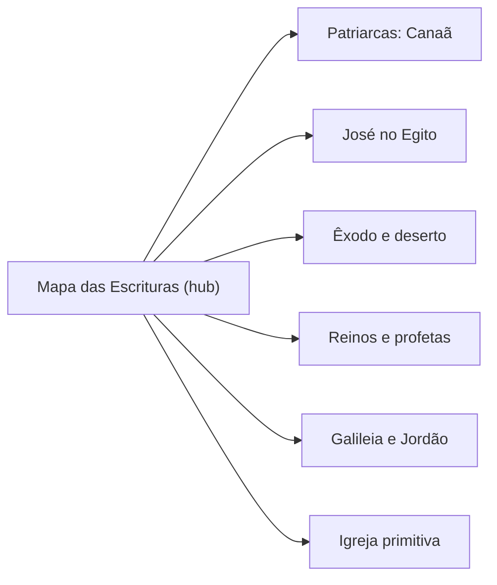

# Game Design — Caminhos da Promessa

## Visão

Um RPG de exploração em pixel art no qual o jogador caminha pelos cenários da
Bíblia, conhece pessoas, observa a vida cotidiana e acompanha de perto os
acontecimentos narrados nas Escrituras. O objetivo é despertar curiosidade e
compreensão do contexto bíblico, não testar conhecimento.

## Pilares

1. **Estar lá** — ambientes vivos e plausíveis (moradores, animais, ofícios, clima).
2. **Fidelidade** — o jogador participa, mas não substitui personagens bíblicos nem reescreve os fatos. Ficção do jogo é sempre identificável.
3. **Descoberta tranquila** — explorar no próprio ritmo; sem pressão de sobrevivência, sem combate como núcleo.
4. **Reverência** — acontecimentos espirituais com tratamento visual e sonoro especial, nunca banalizados em recompensas materiais.
5. **Crescimento por dados** — novas histórias, personagens e regiões entram por arquivos de dados e componentes reutilizáveis.

## Público

Adolescentes, jovens e adultos, inclusive sem conhecimento bíblico prévio.
Textos curtos, linguagem clara, referências disponíveis no diário para quem quiser ler mais.

## O jogador

Um **viajante fictício**, criado para o jogo. Sua presença nunca é apresentada como
registrada nas Escrituras. Personalização (tom de pele, cabelo, roupas, gênero,
acessórios culturalmente apropriados) está planejada; o protótipo usa uma aparência padrão.

## Mecânicas principais

| Mecânica | Protótipo | Futuro |
|---|---|---|
| Movimento 8 direções, corrida | sim | controles configuráveis, gamepad |
| Interação universal (E/Espaço) | conversar, examinar, ler, porta | coletar, entregar, abrir, ativar |
| Diálogos com escolhas e flags | sim | retratos ilustrados, expressões |
| Salvar / continuar | 1 espaço, autosave ao fechar | múltiplos espaços |
| NPCs com comportamento | parado / passeio | rotinas por horário |
| Inventário, coleta | — | Fase 4 |
| Dia/noite, clima, áudio | tom fixo | Fase 4 |
| Diário bíblico | v0.2: Jornada, Escrituras, Personagens, Lugares, Linha do tempo (tecla J) | mapa, pesquisa, mais épocas |
| Missões | v0.2: missões por dados e eventos (1 missão: os poços de Abraão e Isaque) | mais missões e regiões |

## Exploração

Mapas contínuos por região, com pontos de interesse (poço, mercado, curral,
tendas), moradores com identidade e objetos que ensinam algo do contexto quando
examinados. Indicação discreta (balão “E” + verbo) para o que é interativo.

## Progressão e estrutura do mundo

Os acontecimentos bíblicos estão separados por séculos; por isso o mundo **não**
coloca todos os personagens no mesmo espaço. O **Mapa das Escrituras** é um hub
de navegação (recurso do jogo, não um evento bíblico) que dá acesso a
*experiências* organizadas por época, região e livro. Cada experiência é um
pequeno mundo explorável.

O hub registrará: regiões acessíveis e bloqueadas, locais descobertos,
histórias concluídas, referências encontradas e personagens conhecidos.

## Estrutura narrativa

- **Acontecimentos centrais**: preservados como no texto; o jogador acompanha.
- **Atividades complementares**: tarefas plausíveis ao redor do acontecimento (ajudar uma família a arrumar a tenda antes da travessia do mar, organizar a fila no Jordão).
- **Contexto**: objetos e moradores explicam costumes, geografia e ofícios.
- Cada conteúdo carrega uma classificação (ver `bible_catalog.md`) e o diário distingue fato bíblico de criação do jogo.

Exemplo do que **não** fazer: impedir a venda de José, decidir prendê-lo, ou
“ganhar” um milagre como recompensa.

## Missões e aprendizado (implementado na v0.2)

Sistema descrito em [quests.md](quests.md). Missões orientadas a dados avançam por eventos.
- Tipos: `context_exploration`, `story_witness`, `assist`, `investigation`, `journey`.
- Cada objetivo tem 3 pistas progressivas (tecla H), nunca impostas.
- O jogador aprende pelo **contexto**:
  - painel bíblico com a referência ativa;
  - descobertas com níveis de profundidade (aviso, cartão, diário);
  - apresentação das passagens com referência a cada trecho.

Não há questionários. A conclusão traz um cartão "História explorada" com o resumo.

Ideias para próximas missões: acompanhar caravanas, investigar locais, organizar
atividades, orientar grupos e presenciar acontecimentos, sempre sem alterar os relatos.

## Escopo do primeiro protótipo (v0.1)

Uma aldeia fictícia em Canaã, na época dos patriarcas:
- menu inicial (novo jogo, continuar, configurações, créditos, sair);
- aldeia de 60 × 40 tiles com caminhos, praça com poço, 3 casas, tenda, mercado, curral, olival;
- jogador controlável com câmera, colisões e profundidade;
- 4 moradores e 3 ovelhas com comportamento;
- 20 pontos de interação (moradores, animais, poço, forno, portas, tenda, bancas, fogueira, marcos, diário);
- diálogos com escolhas e memória (flags);
- pausa com salvar, salvar e sair; continuar restaura posição e progresso.
