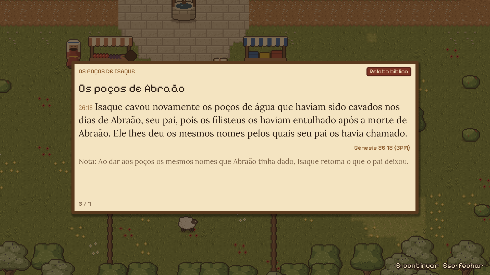
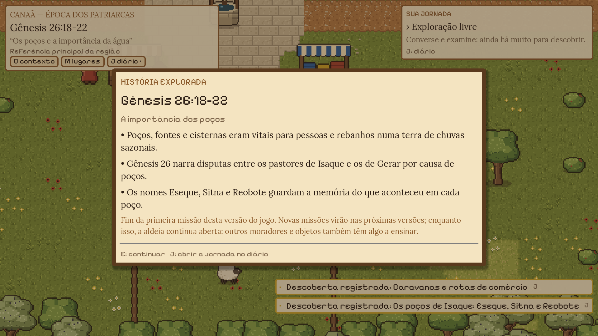
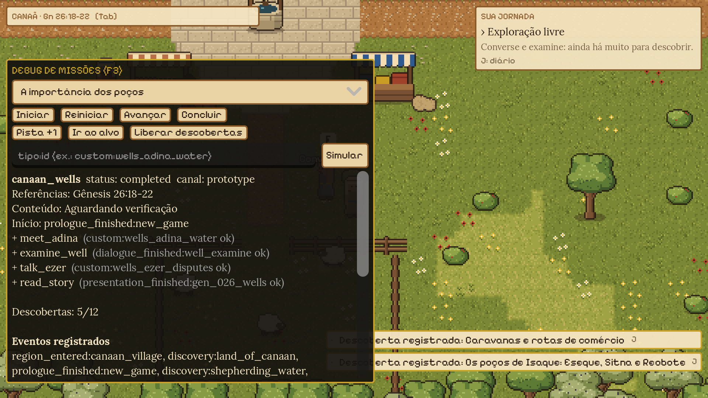

# Missões, contexto histórico e aprendizado bíblico

Sistemas introduzidos na v0.2.0: prólogo, painel de contexto bíblico, "Sua jornada"
com pistas progressivas, descobertas, diário, cronologia, missões orientadas a dados,
editor de missões, painel de debug e validador de conteúdo.


## Princípios (aplicados no código e nos dados)

- O jogador é um **viajante fictício**. Ele observa e conversa, mas não altera os relatos.
- Moradores (Adina, Ezer, Yaron, Ari) e a aldeia são **ficção identificada**. O diário diz "Criado para o jogo. Não aparece na Bíblia".
- Personagens bíblicos **não ganham falas inventadas**. O relato aparece numa apresentação à parte, com o **texto dos versículos** (tradução importada, ver [bible_catalog.md](bible_catalog.md#texto-bíblico-no-jogo)) e uma nota própria do jogo em cada passo.
- Nenhuma data é inventada.
  - Épocas e acontecimentos sem datação usam `span: null` e aparecem como "cronologia aproximada e debatida" ou "sem datação atribuída".
  - Não existe ano zero (`Chronology`).
- Conteúdo gerado ou conferido por IA fica como **"Aguardando verificação"**. `reference_checked` e `approved` exigem um revisor humano, e nomes de IA são recusados (`ContentPolicy.is_ai_reviewer`).

## Fluxo do jogador

1. **Novo jogo → prólogo** (`data/story/prologues.json`, `scripts/ui/cinematic.gd`). A sequência é:
   - título;
   - revelação do cenário com a câmera no poço;
   - "Região de Canaã — Período dos patriarcas — cronologia aproximada e debatida";
   - textos de contexto (Gn 26:18-22);
   - nota sobre o viajante fictício;
   - o objetivo inicial.

   E avança e Esc pula. O prólogo só toca uma vez (flag `prologue_seen`). Pode ser revisto em **Pausa → Rever abertura**; rever não reinicia a missão.
2. Ao fim do prólogo, o evento `prologue_finished:new_game` inicia **"A importância dos poços"**.
3. O **painel de contexto** (canto superior esquerdo) mostra "CANAÃ — ÉPOCA DOS PATRIARCAS", "Gênesis 26:18-22", o tema e a origem do contexto.
   - A origem é "Experiência ativa" ou "Referência principal da região".
   - Tem os botões C (contexto), M (lugares) e J (diário). O botão do diário ganha "•" quando há descobertas novas.
   - **Tab** recolhe o painel numa linha; a preferência é salva.
4. **Sua jornada** (canto superior direito) mostra o objetivo e o detalhe. No mapa, uma **seta dourada** (`ObjectiveGuide`) fica sobre o alvo do objetivo atual, ou na borda da tela apontando para ele quando está fora de vista; some em diálogos, menus e quando o alvo já está ao alcance do "E".
   - **H** revela pistas em 3 níveis: indireta → contextual → objetiva.
   - Depois de 150 s no mesmo objetivo sem pedir pista, "H: pedir pista" pulsa. É um lembrete, nunca uma resposta automática.
5. A missão segue estes objetivos:

   | # | Objetivo | Conclui com | Alvo |
   |---|---|---|---|
   | 1 | Converse com Adina, a pastora | evento `wells_adina_water`, emitido no diálogo de Adina | NPC `adina` |
   | 2 | Examine o poço no centro da praça | `dialogue_finished:well_examine` | diálogo `well_examine` |
   | 3 | Pergunte a Ari sobre o poço | evento `wells_ari_well`, emitido no diálogo de Ari | NPC `ari` |
   | 4 | Converse com Ezer | evento `wells_ezer_disputes` | NPC `ezer` |
   | 5 | Leia o diário de viagem sobre a pedra, ao lado do poço | `presentation_finished:gen_026_wells` | diário de viagem |

   Os objetivos são **retroativos**. Se o jogador já tiver falado com Ezer antes, o objetivo 4 se completa sozinho quando se torna o atual. O objetivo 3 (`listen_ari`) entrou na v0.3 pela fábrica de missões (episódio `ep_006`); saves anteriores continuam válidos (testado em `_test_old_save_listen_ari`).
6. O **diário de viagem** abre a apresentação de Gn 26 em 7 passos, cada um com o texto dos versículos e uma "Nota" do jogo:
   - Gn 26:12-14;
   - 15-17;
   - 18;
   - 19-20 (Eseque);
   - 21 (Sitna);
   - 22 (Reobote);
   - uma nota final: as notas são do jogo, Adina, Ezer, Ari e a aldeia são fictícios, e o crédito da tradução.

   Fechar com Esc antes do fim não conclui o objetivo. A apresentação também abre pelo diário (J → Minha jornada → **E: Ler o relato bíblico**) a qualquer momento; terminá-la por ali também conclui o objetivo 5.
7. O cartão **"HISTÓRIA EXPLORADA"** mostra a referência e três pontos de resumo, avisa que esta é a última missão da versão e volta à exploração livre. Não há questionário.

 

## Descobertas

São definidas em `data/bible/discoveries.json` e liberadas por:
- nós de diálogo (`"unlock": [...]`);
- objetivos;
- apresentações;
- entrada na região (`context.discoveries_on_enter`).

Cada descoberta tem:
- classificação;
- época;
- resumo;
- "Na Bíblia";
- referências;
- seções tipadas (`biblical_text`, `historical`, `chronology`, `interpretation`, `fiction`);
- vínculos (pessoas, lugares, acontecimentos, histórias);
- verificação.

Profundidade da apresentação:
- `presentation: "card"` gera um cartão central na primeira vez (modo "Completos").
- `"toast"` gera um aviso discreto no canto.
- Tudo fica no diário para consulta.

**Avisos educativos** (Pausa ou Configurações):

| Modo | Efeito |
|---|---|
| Completos | Cartões e avisos |
| Discretos | Só avisos curtos |
| Mínimos | Apenas o registro no diário |

Cartões e avisos esperam o fim de diálogos, cenas e do diário para não se sobrepor.

## Diário (J)

| Seção | Conteúdo |
|---|---|
| Minha jornada | Missões agrupadas por categoria (História principal, Secundárias, Exploração) e depois "Concluídas": objetivos feitos (+), atual (›), futuros ocultos, pistas reveladas, resumo final (com o desfecho da escolha feita), personagens fictícios da missão e o botão "E: Ler o relato bíblico" (depois de lido, "E: Rever o relato"). Missões sem relato oferecem "E: Acompanhar no HUD" / "Deixar de acompanhar". Também traz o registro da viagem (viagens, experiências, colecionáveis, decisões). |
| Descobertas | "Minhas descobertas": colecionáveis encontrados por região e conjunto, com o progresso de cada conjunto. |
| Escrituras | Livros com as passagens encontradas (e de onde vieram), com o texto dos versículos e o crédito da tradução; descobertas completas com seções, referências e o texto das passagens curtas |
| Personagens | Bíblicos (resumo, relações, momentos, referências) e moradores fictícios marcados como tais |
| Lugares | Identificação: amplamente aceita, provável, debatida ou fictícia. Também referências e épocas. |
| Linha do tempo | "Como ler as datas" (a.C./d.C., sem ano zero, "c."). Épocas em ordem, com hipóteses de datação (ex.: Êxodo antiga × tardia), acontecimentos descobertos, marcos documentados e suas experiências naquela época. |

Tab troca de seção, setas percorrem a lista, J/Esc fecha. O jogo fica pausado.

## Formato de missão (`data/quests/<região>/*.json`, chave `quests`)

```json
{
  "id": "canaan_wells", "title": "...", "description": "...",
  "type": "context_exploration | story_witness | assist | investigation | journey",
  "classification": "plausible_fiction", "classification_note": "...",
  "region": "canaan_village", "place_id": "canaan", "era_id": "patriarchs",
  "references": ["Gen 26:18-22"], "theme": "...",
  "people": ["isaac"], "fictional_characters": ["adina", "ezer"],
  "intro": "...",
  "start": {"event": "prologue_finished", "id": "new_game"},
  "prerequisites": {"quests_completed": [], "flags": []},
  "objectives": [{
    "id": "meet_adina", "text": "...", "detail": "...",
    "complete_on": {"event": "custom", "id": "wells_adina_water"},
    "targets": [{"type": "npc", "id": "adina"}],
    "hints": ["indireta", "contextual", "objetiva"],
    "unlock": [], "log": "..."
  }],
  "discoveries": ["..."],
  "completion": {"title": "História explorada", "references": [], "summary": ["..."], "unlock": [], "next": "..."},
  "verification": {"status": "pending_review", "reviewer": "", "notes": "..."}
}
```

**Eventos** (`QuestManager.record_event(tipo, id)`):

| Evento | Quando é registrado |
|---|---|
| `dialogue_finished` | Fim de um diálogo |
| `interact` | Interação com um objeto ou NPC |
| `custom` | Nó de diálogo com `"event"` |
| `presentation_finished` | Fim de uma apresentação |
| `discovery` | Descoberta liberada |
| `region_entered` | Entrada numa região |
| `prologue_finished` | Fim do prólogo |
| `quest_completed` | Missão concluída |
| `item_collected` / `item_received` / `item_delivered` | Item pego no mapa / recebido (diálogo ou recompensa) / entregue num diálogo |
| `choice_made` | Efeito `decision` de uma escolha (registra `id` e `id:opção`) |
| `experience_started` | Experiência iniciada no Mapa das Escrituras |
| `location_reached` | Jogador entrou numa área (`areas` do JSON da região) |
| `collectible_found` / `collection_completed` | Colecionável encontrado / conjunto completo |
| `region_unlocked` | Região liberada |
| `flag`, `inventory`, `collection`, `condition` | Gatilhos de **estado**, reavaliados a cada avaliação: flag, quantidade na bolsa (`id` + `count`), progresso de conjunto (`id` + `count`) e condição composta (`if`) |

Cada evento vira a flag `ev:<tipo>:<id>` no save, o que permite completar objetivos de forma retroativa.
Os gatilhos de estado não são gravados: valem enquanto o estado vale.

**Campos novos da missão (v0.4):**
- `category`: `main` (principal), `side` (secundária) ou `exploration`. A principal ativa aparece no HUD; uma secundária pode ser acompanhada pelo diário.
- `type` no objetivo (opcional): `talk_to_npc`, `inspect_object`, `visit_region`, `reach_location`, `collect_item`, `deliver_item`, `give_item`, `receive_item`, `make_choice`, `wait_for_event`, `discover_information`, `complete_dialogue`, `interact_with_object`, `unlock_region`, `read_scripture`. O validador confere se o evento de `complete_on` combina com o tipo. `escort_npc` existe na lista, mas **não é suportado** (sem eventos; fica pendente).
- `region` no objetivo (opcional): região onde ele acontece, se diferente da região da missão; `""` para objetivos de interface.
- Alvos (`targets[].type`): `npc`, `dialogue`, `examinable`, `pickup`, `area`, `exit`, `region` (outra região) e `ui` (`scripture_map`, `inventory`, `journal`). Se o alvo está em outra região, a seta aponta para a saída da rota e o HUD mostra "Siga para: <saída>".
- `rewards`: `{"items": [{"item", "qty"}], "flags": {...}}`, concedidas uma única vez (flag `reward:<id>`).
- `completion.variants`: `[{"if": condição, "title"?, "summary"?, "next"?}]`; vale a primeira cuja condição é verdadeira (desfechos de escolha).

**Validação** (testes, validador e editor):
- campos obrigatórios;
- exatamente 3 pistas;
- alvos obrigatórios;
- referências conferidas contra `verse_counts.json`;
- época, lugar, região, pessoas, personagens, descobertas e pré-requisitos existentes;
- diálogos e apresentações citados existentes;
- algum diálogo emite cada evento `custom`;
- cada alvo existe no mapa da região (teste);
- status de verificação válido.

### Condições e efeitos
Condições (`Conditions`, `scripts/core/conditions.gd`), usadas em `start_if` e no `if` das escolhas, nas
saídas de mapa, nos NPCs, nas experiências e nos gatilhos `condition`:
- combinação: lista ou `{"all": [...]}`, `{"any": [...]}`, `{"not": c}`;
- chaves: `flag` (+ `value`), `not_flag`, `objective: "missão/objetivo"`, `quest_completed`, `quest_active`, `quest_started`, `discovery`, `event` + `id`, `has_item` (+ `count`), `lacks_item`, `choice` + `option` (sem `option` = escolha ainda não feita), `collectibles` + `count`, `collectible`, `region`.

Efeitos de nó ou de escolha: `set_flags`/`flags`, `unlock` (descoberta), `event` (evento `custom`),
`action: {"presentation": id}`, `give` / `take` (`[{"item", "qty"}]`; `take` é tudo ou nada, `give` acontece
uma vez por nó/escolha, salvo `"repeatable": true`), `decision: {"id", "option"}`, `grant_collectible`.

## Cronologia (`data/bible/chronology.json`)

- Anos inteiros: negativo = a.C., positivo = d.C., **nunca 0**.
- `span = {from, to, precision: year|century, certainty: documented|approximate|debated|unknown}`. `null` significa sem datação.
- `Chronology.format_span` produz textos como "722/721 a.C.", "c. 27–30 d.C.", "séculos XII–XI a.C. (aproximado)" ou "cronologia incerta".
- Épocas debatidas trazem `hypotheses` com base e referências. Acontecimentos com `anchor: true` aparecem como marcos.

## Ferramentas

### Editor de missões (plugin do Godot)

`addons/quest_editor`, ativado em `project.godot`. Aba **Missões** no painel inferior do editor. Ele permite:
- buscar por id, título ou referência;
- filtrar por livro, região, época e status;
- ver o resumo com objetivos, pistas, alvos e problemas de validação;
- editar o JSON da missão e os diálogos;
- inserir modelos (objetivo, referência, alvo) e ids (personagens, pessoas bíblicas, descobertas, apresentações, diálogos);
- criar uma missão nova (nasce como rascunho);
- alterar status e revisor (recusa IA);
- **Testar missão**, que inicia o jogo já com a missão ativa e sem prólogo.

O plugin não vai para a build: `addons/*` está excluído na exportação.

### Painel de debug (F3)

Só existe em builds de debug (rodando pelo editor). O script é excluído da exportação, e o autoteste do .exe confirma isso. Funções:
- escolher a missão;
- iniciar, reiniciar, avançar e concluir;
- pista +1;
- ir ao alvo (teleporte);
- liberar todas as descobertas;
- simular evento (`tipo:id`);
- ver status, gatilhos (com "ok" se já ocorreram), pré-requisitos faltantes, eventos registrados e histórico.



### Validador de conteúdo

```powershell
.\tools\godot\Godot_v4.7.2-stable_win64_console.exe --headless --path . --script res://tools/validate_content.gd
```

Falha com erros de dados. Lista por tipo quantos itens estão em cada status e quais ainda não podem ir ao canal público. Roda dentro de `criar_exe_atualizado.bat`.

Canal de conteúdo: `caminhos/content/channel` em `project.godot`.
- `prototype` mostra tudo que não é rascunho.
- `public` mostra só o que foi aprovado por uma pessoa.

Hoje nada está aprovado, então **uma build pública não teria conteúdo bíblico**. Isso é intencional até a revisão humana.

## Como testar

### Automático

```powershell
$g = ".\tools\godot\Godot_v4.7.2-stable_win64_console.exe"
& $g --headless --path . res://tests/test_runner.tscn          # 548 verificações (v0.4.0)
& $g --headless --path . --script res://tests/flow_smoke.gd    # fluxo pelos menus (17)
& $g --headless --path . --script res://tools/validate_content.gd
.\criar_exe_atualizado.bat                                     # tudo acima + exportação + autoteste do .exe
```

### Manual (roteiro sugerido, cerca de 10 minutos)

1. Menu → **Novo jogo**.
   - Confira o prólogo e avance com E.
   - Na tela "Região de Canaã", confira se aparece "cronologia aproximada e debatida".
   - Termine e veja o painel de contexto e "Sua jornada".
2. Pressione **H** três vezes e veja as pistas ficando mais diretas. Pressione **Tab** duas vezes para recolher e expandir o painel.
3. Fale com **Adina**, ao sul do poço. Deve aparecer o cartão "Pastoreio nos tempos bíblicos" e o objetivo deve mudar.
4. Examine o **poço**, fale com **Ari** (o menino perto do poço), depois com **Ezer** (ao norte) e então leia o **diário de viagem**, ao lado do poço.
   - Percorra a apresentação.
   - Teste fechar com Esc no meio e reabrir.
5. Veja o cartão "HISTÓRIA EXPLORADA" e depois "Exploração livre".
6. **J** → percorra as cinco seções. Confira:
   - Adina como fictícia;
   - Isaque como bíblico;
   - Gerar como "identificação provável";
   - a linha do tempo sem anos para os patriarcas.
7. **Esc** → teste "Rever abertura" e "Avisos educativos" (alterne para Mínimos e examine o forno).
8. Salve, volte ao menu e use **Continuar**. O prólogo não deve repetir, e o progresso e as pistas devem continuar.
9. Pelo editor (F5): **F3** abre o painel de debug. Teste "Reiniciar" e "Simular" (`custom:wells_adina_water`).

### Manual da v0.4 (depois dos poços, cerca de 20 minutos)
1. Ao concluir os poços, começa "O caminho para Dotã". Pressione **M**: confira as épocas, o cartão "OUTRO MOMENTO DA HISTÓRIA" e confirme com E. O botão "Atlas de lugares" abre o diário em Lugares.
2. Fale com **Adina** (pastos distantes) e saia pela **estrada do leste**. Confira o escurecimento, o título "Caminho das Caravanas" e o salvamento automático.
3. Na estrada: pegue **fibras** e **lenha** (I abre a bolsa), fale com **Malik** (pedido de suprimentos, entrega, recompensa e a escolha de aceitar ou recusar o pano), procure os **registros da caravana** (marcos, rastros, fogueira, fardo, jarro).
4. Vá a **Dotã**, olhe o vale do mirante e leia o relato (Gn 37:12-17).
5. Fale com **Rafi** (cesto), ouça **Talia** e **Oren** e escolha: cesto para Talia, para Oren, ou dividir (odre para Oren, cesto para Talia). Volte ao Rafi.
6. Volte à aldeia e retorne: coletáveis pegos não reaparecem; salve, carregue e confira a bolsa, a escolha e o diário (abas Jornada e Descobertas).
